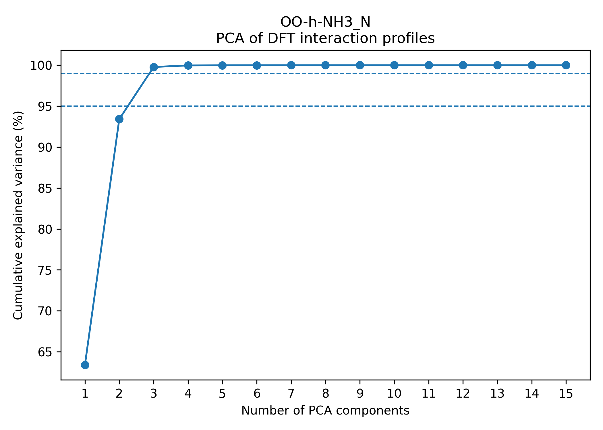
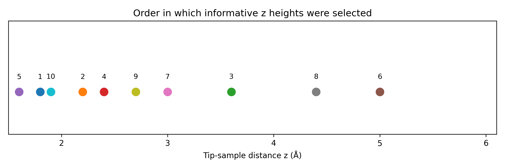
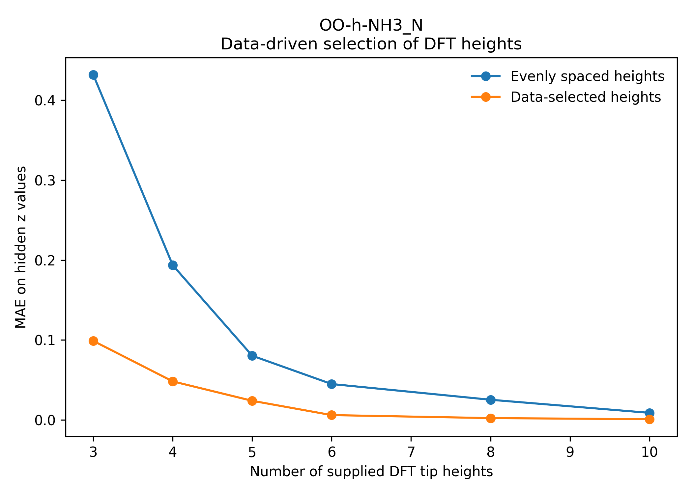
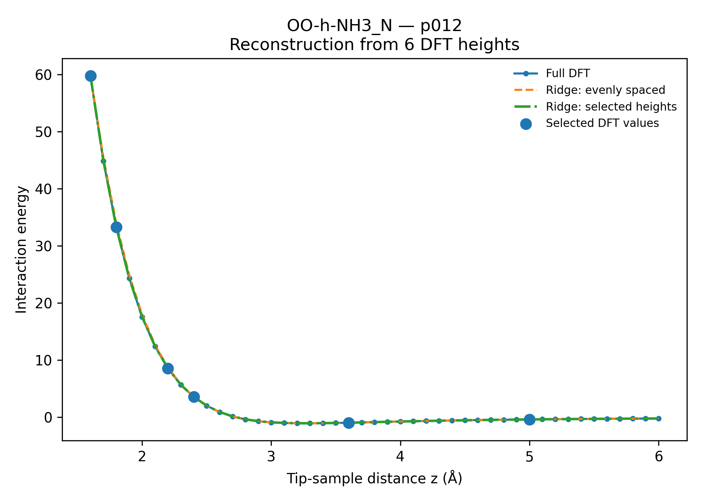
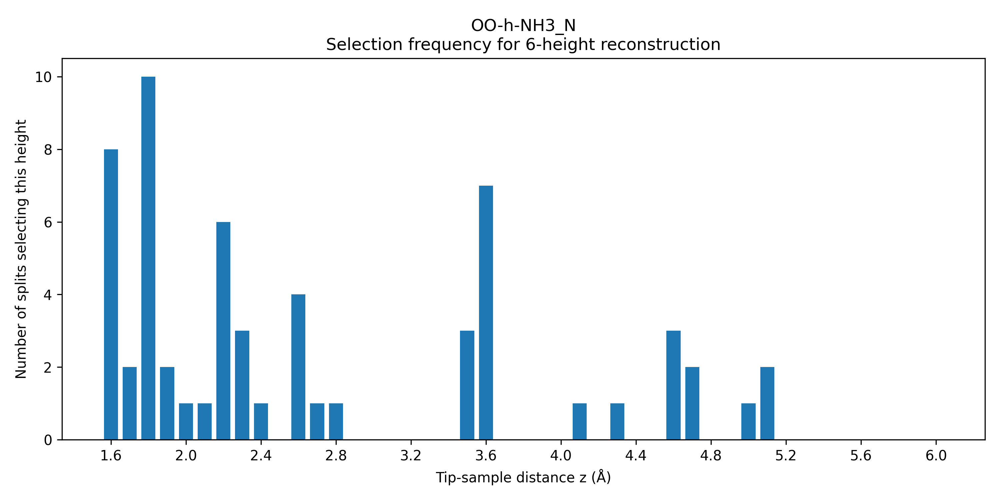
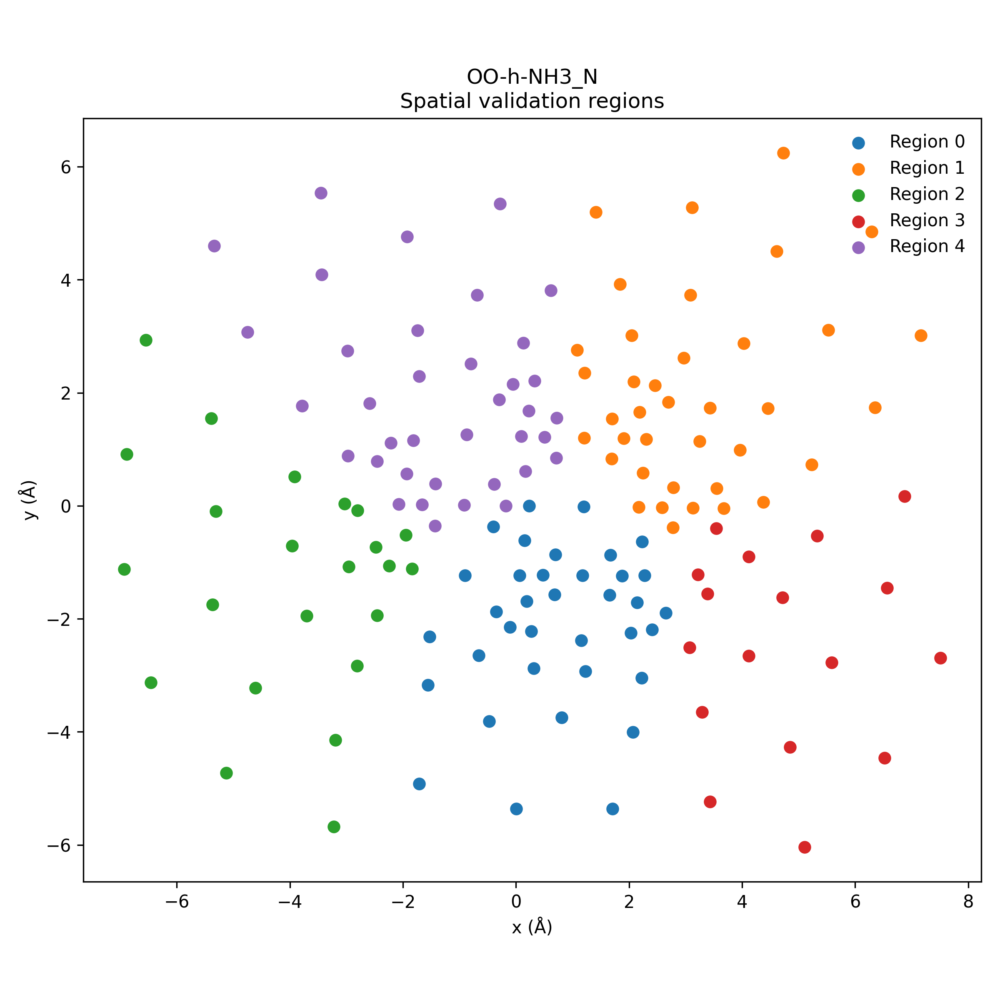
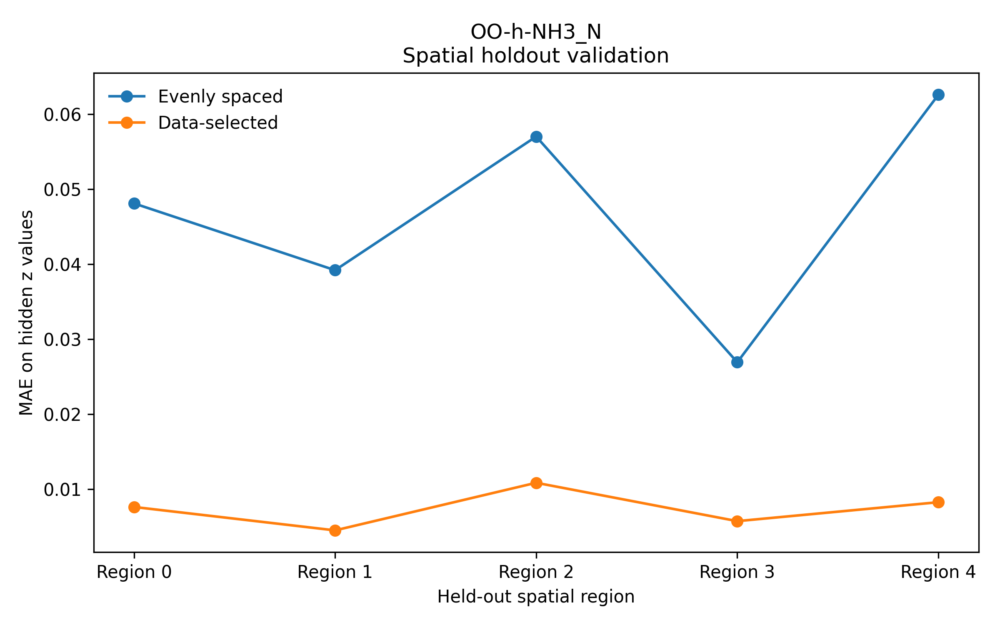

# Sparse Profile Reconstruction with Machine Learning

**Feature selection, dimensionality reduction, multi-output regression, and robust validation on expensive scientific simulation data.**

This project investigates whether a **high-dimensional response profile can be reconstructed from only a small subset of strategically selected observations**.

The original dataset contains profiles with **45 measurements per sample**. Rather than evaluating all 45 positions, the goal is to identify a small number of informative measurements and use machine learning to reconstruct the complete profile.

The central ML question is:

> **Can we reconstruct a 45-dimensional response vector accurately using only a small subset of intelligently selected input features?**

---

## Key results

For the initial benchmark system:

- **151 complete response profiles**
- **45 measurements per profile**
- **3 principal components explain 99.78%** of the standardized profile variance
- A **multi-output Ridge regression** model reconstructs the complete 45-dimensional profile
- **Greedy forward feature selection** identifies the most informative measurement positions
- Model performance is compared against a simple **evenly spaced sampling baseline**

Using only **6 selected measurements instead of all 45**:

### Repeated random train/test evaluation

Across 10 independent train/test splits:

| Method | MAE |
|---|---:|
| Selected features + Ridge | **0.00623 ± 0.00103** |
| Evenly spaced features + Ridge | **0.04719 ± 0.00479** |

Average relative MAE reduction:

**86.74 ± 2.19%**

### Spatial holdout evaluation

Using five spatially separated holdout regions:

| Method | MAE |
|---|---:|
| Selected features + Ridge | **0.00742 ± 0.00244** |
| Evenly spaced features + Ridge | **0.04676 ± 0.01420** |

The selected model remained substantially better than the evenly spaced baseline when evaluated on spatial regions excluded from training.

### Sampling reduction

Six observations correspond to:

- **13.3% of the original 45 measurement positions**
- **86.7% fewer sampled positions**

This does **not** imply an identical 86.7% reduction in computational wall time, because the cost of the underlying simulation does not necessarily scale linearly with the number of sampled positions.

---

## ML skills demonstrated

This project implements an end-to-end machine-learning workflow for sparse reconstruction of structured, high-dimensional data.

### Modeling

- Supervised learning
- Multi-output regression
- Ridge regression and regularization
- Dimensionality reduction using PCA
- Reconstruction of high-dimensional continuous profiles

### Feature selection and experimental design

- Greedy forward feature selection
- Data-driven measurement selection
- Identification of informative input positions
- Comparison against a conventional evenly spaced baseline
- Sparse sensing / experimental-design formulation

### Model evaluation

- Train/test separation at the complete-profile level
- Cross-validation for feature selection
- Repeated independent train/test experiments
- Spatial holdout validation
- Baseline comparison
- Error analysis using MAE
- Data-leakage prevention

### ML engineering

- Automated preprocessing of structured simulation data
- Validation of input consistency
- Reproducible experiment scripts
- Export of model predictions in the original data format
- Downstream validation through an independent simulation pipeline

### Tools

- Python
- NumPy
- pandas
- SciPy
- scikit-learn
- Matplotlib
- Git
- GitHub

---

## ML problem formulation

Each sample is represented by a complete response vector:

\[
\mathbf{y}
=
[y_1,y_2,\ldots,y_{45}]
\]

Instead of observing every element, only a subset is provided to the model:

\[
\mathbf{x}
=
[y_{i_1},y_{i_2},\ldots,y_{i_k}]
\]

where:

\[
k \ll 45
\]

The model learns the mapping:

\[
\mathbf{x}
\rightarrow
\mathbf{y}
\]

For example:

```text
Complete profile
45 measurements
        ↓
Select 6 informative measurements
        ↓
[x1, x2, x3, x4, x5, x6]
        ↓
Multi-output regression
        ↓
Reconstructed 45-dimensional profile
```

This formulation combines three common ML problems:

1. **dimensionality reduction**
2. **feature selection**
3. **multi-output regression**

---

## Why this problem matters

Many scientific and engineering workflows involve expensive measurements or simulations collected over:

- time
- distance
- frequency
- temperature
- pressure
- spatial position
- operating conditions

Often, neighboring measurements are strongly correlated.

If the underlying response has a low-dimensional structure, evaluating every possible position may be unnecessary.

A machine-learning system can instead identify the most informative measurements and reconstruct the missing values.

The general workflow is therefore:

```text
Expensive high-dimensional measurement
                  ↓
        Dimensionality analysis
                  ↓
        Sparse feature selection
                  ↓
        Multi-output regression
                  ↓
        Robust validation
                  ↓
      Downstream application test
```

## Training, validation, testing, and inference

The workflow explicitly separates **model training, model/feature selection, final evaluation, and inference** to reduce data leakage and produce a more realistic estimate of generalization performance.

### Training

Each complete 45-point response profile is treated as one sample.

For the initial experiments, complete profiles are split into:

```text
80% training profiles
20% held-out test profiles
```

All measurements belonging to a profile remain in the same split.

This is important because randomly splitting individual measurements from the same profile would allow closely related information from one response curve to appear in both training and test data.

The training set is used to:

- fit preprocessing transformations,
- fit PCA,
- train Ridge regression models,
- perform feature selection.

Conceptually:

```text
Complete profiles
       ↓
train/test split
       ↓
Training profiles
       ↓
model fitting
```

---

### Validation

Model and feature-selection decisions are made using only the training data.

A **5-fold cross-validation** procedure is used inside the training set.

For feature selection:

```text
Training profiles
       ↓
5-fold cross-validation
       ↓
evaluate candidate measurement positions
       ↓
select best position
       ↓
repeat
```

At each feature-selection step, candidate measurement positions are compared according to their cross-validated reconstruction error.

The held-out test profiles are never used to determine which measurements should be selected.

This creates a separation between:

```text
training
    ↓
model fitting

validation
    ↓
model / feature selection

test
    ↓
final performance estimate
```

---

### Testing

After the measurement positions have been selected using training-only cross-validation, the resulting model is evaluated on the untouched test profiles.

The main metric is **mean absolute error (MAE)** over the unobserved portions of the reconstructed profile.

For the repeated random-split experiment, the complete procedure is repeated across 10 independent train/test splits:

```text
Split 1
training → CV selection → test

Split 2
training → CV selection → test

...

Split 10
training → CV selection → test
```

This provides both an average performance estimate and a measure of variability across different data splits.

A second evaluation uses **spatial holdout testing**, where complete spatial regions are excluded from training.

This tests whether the model can reconstruct profiles from locations that are spatially separated from the training data.

---

### Inference

After a model has been trained, inference requires only the selected sparse measurements for a new profile.

For example, with six selected measurements:

```text
New profile

Observed:
E(z1)
E(z2)
E(z3)
E(z4)
E(z5)
E(z6)

        ↓

trained Ridge model

        ↓

Predicted complete profile

[E(z0), E(z1), ..., E(z44)]
```

The inference input therefore has dimension:

\[
\mathbf{x}_{new} \in \mathbb{R}^{6}
\]

while the model predicts:

\[
\hat{\mathbf{y}}_{new} \in \mathbb{R}^{45}.
\]

The predicted profile can then be exported in the same format as the original simulation data and passed to downstream analysis software.

```text
6 sparse observations
        ↓
ML inference
        ↓
45-point reconstructed profile
        ↓
downstream simulation / analysis
```

---

### Evaluation inference vs deployment inference

The project distinguishes between two types of prediction.

**Evaluation predictions** are generated for held-out profiles so that reconstruction accuracy can be measured against known ground truth.

```text
known full profile
      ↓
hide most measurements
      ↓
predict hidden measurements
      ↓
compare prediction with ground truth
```

**Deployment inference** represents the intended future use case:

```text
new expensive sample
      ↓
calculate only selected measurements
      ↓
trained model
      ↓
predict remaining measurements
```

In this situation, the complete ground-truth profile would not need to be calculated.

The current project primarily validates the first scenario. Generalized deployment to completely unseen chemical systems remains a future extension.---

## Dimensionality analysis

Before training a reconstruction model, PCA was used to determine whether the 45-dimensional response profiles contain substantial redundancy.

The profiles were standardized using statistics derived from the training data.

For the initial benchmark system:

| Number of PCs | Explained variance |
|---:|---:|
| 1 | 63.39% |
| 2 | 93.42% |
| 3 | **99.78%** |
| 4 | 99.97% |
| 5 | 99.996% |

The first three principal components therefore capture nearly all of the standardized profile variation.

This strong low-dimensional structure motivated the sparse-reconstruction approach.



---

## Sparse reconstruction models

Several approaches were compared.

### PCHIP interpolation

A shape-preserving cubic interpolation method was used as a non-ML baseline.

It reconstructs missing values using only the observed positions within an individual profile.

### PCA reconstruction

Profiles were represented in a low-dimensional PCA basis.

This tests whether the learned latent structure alone is sufficient for sparse reconstruction.

### Multi-output Ridge regression

The main supervised-learning model uses the selected observations as input features and predicts the entire profile simultaneously.

For \(k\) observed measurements:

\[
\mathbf{x}
\in
\mathbb{R}^{k}
\]

and the model predicts:

\[
\hat{\mathbf{y}}
\in
\mathbb{R}^{45}
\]

Ridge regression was chosen deliberately as a simple, regularized, interpretable baseline before introducing more complex models.

---

## Why Ridge regression works well here

The response profiles are:

- smooth,
- strongly correlated,
- highly structured,
- approximately low-dimensional.

Therefore, a complex neural network is not necessarily required.

A regularized linear model can exploit correlations between the measured and unmeasured positions while remaining:

- easy to interpret,
- computationally inexpensive,
- stable for relatively small datasets,
- straightforward to cross-validate.

This is also an example of choosing model complexity based on the structure of the problem rather than automatically using a deep-learning architecture.

---

## Data-driven feature selection

A key part of the project is determining **which measurements should be taken**.

Instead of simply choosing evenly spaced positions, the project uses **greedy forward feature selection**.

Starting with no selected positions:

1. Every remaining candidate measurement is considered.
2. A Ridge model is evaluated using cross-validation on the training data.
3. The candidate that produces the lowest reconstruction error is selected.
4. The procedure repeats until the desired number of measurements is reached.

Conceptually:

```text
0 selected
    ↓
test all 45 candidates
    ↓
select best measurement
    ↓
test remaining 44
    ↓
select next best
    ↓
...
    ↓
6 informative measurements
```

For one representative split, six selected positions corresponded to:

```text
1.6, 1.8, 2.2, 2.4, 3.6, 5.0 Å
```

The selected positions concentrate measurements in regions where the response varies most strongly while retaining longer-range measurements that help constrain the complete profile.



---

## Selected features vs evenly spaced sampling

A central baseline asks:

> If six measurements are available, is data-driven feature selection actually better than simply sampling six uniformly spaced positions?

The answer was consistently yes for the benchmark system.



As more measurements are added, both approaches improve. However, learned measurement selection achieves substantially lower reconstruction error when the measurement budget is small.

This is important because the practical objective is not merely to reconstruct profiles accurately, but to do so using as few expensive measurements as possible.

---

## Example reconstruction

A representative reconstructed profile using six observations is shown below.



The selected measurements serve as sparse inputs, while the model predicts the remaining positions.

---

## Validation strategy

Good performance on a single random train/test split is not sufficient.

Several validation strategies were therefore used.

### 1. Complete-profile train/test splitting

Individual positions from the same profile are **not** randomly distributed across training and test sets.

Instead, complete profiles are assigned to either training or test data.

This prevents direct leakage between observed and hidden measurements belonging to the same response curve.

---

### 2. Cross-validation during feature selection

The measurement positions are chosen using only training data.

The held-out test profiles do not participate in feature selection.

This prevents the final evaluation set from influencing the selected measurement positions.

---

### 3. Repeated random train/test experiments

The entire feature-selection and evaluation process was repeated across **10 independent train/test splits**.

The selected-feature model achieved:

\[
MAE =
0.00623 \pm 0.00103
\]

compared with:

\[
MAE =
0.04719 \pm 0.00479
\]

for evenly spaced sampling.

The average improvement was:

\[
86.74 \pm 2.19\%
\]

The repeated experiments reduce dependence on a single favorable split.

---

## Feature-selection stability

The most informative measurement positions were also examined across repeated experiments.

Several positions were repeatedly selected, suggesting that the model is identifying reproducible structure rather than arbitrary features from a single data split.



For example, the measurement near 1.8 Å was selected in all 10 repeated experiments in the initial benchmark.

---

## Spatial holdout validation

Random train/test splitting can still produce training and test samples from nearby spatial locations.

To create a more difficult test, the lateral sampling coordinates were partitioned into compact spatial regions using geometry only.

One complete region was held out at a time.

```text
Spatial coordinates
       ↓
geometry-based clustering
       ↓
+----------+----------+
| training | held-out |
| regions  |  region  |
+----------+----------+
       ↓
train + feature selection
       ↓
evaluate unseen region
```

The response values were **not** used to define the regions.



Across five spatial holdouts:

\[
MAE_{\text{selected}}
=
0.00742 \pm 0.00244
\]

compared with:

\[
MAE_{\text{even}}
=
0.04676 \pm 0.01420
\]

for evenly spaced measurements.



The selected-feature model therefore remained substantially better than the baseline even when entire spatial regions were excluded from training.

---

## Data preprocessing pipeline

The raw data consist of response values associated with:

- lateral sample position,
- vertical measurement index,
- response value.

The preprocessing pipeline converts these files into:

```text
raw files
    ↓
validation
    ↓
coordinate mapping
    ↓
long-format table
    ↓
Np × 45 response matrix
    ↓
ML-ready dataset
```

For each dataset, the preprocessing code generates:

- validated metadata
- coordinate tables
- long-format data
- response matrices
- diagnostic plots

The preprocessing pipeline successfully parsed **132 sample–tip datasets**.

Cross-system ML generalization has not yet been established, so the current headline results should not be interpreted as universal performance across unseen chemical systems.

---

## Domain context

The application data come from **computational chemistry**.

The response profiles represent interaction energies between an AFM probe and a molecular sample calculated at multiple vertical separations using electronic-structure simulations.

For the benchmark data, each profile contains 45 interaction-energy values:

```text
z00 = 1.6 Å
z01 = 1.7 Å
...
z44 = 6.0 Å
```

Each profile is associated with one lateral position:

\[
p_i = (x_i,y_i)
\]

The scientific objective is to use these interaction energies to construct a continuous three-dimensional force field for probe-particle atomic force microscopy.

However, the ML methodology is not specific to chemistry.

The same sparse-reconstruction framework could apply to expensive measurements in other domains where responses are highly correlated across an ordered measurement axis.

---

## Data format

The original interaction-energy files have the form:

```text
p000 z00 ENERGY
p000 z01 ENERGY
...
p000 z44 ENERGY

p001 z00 ENERGY
...
```

Each `pXXX` corresponds to one lateral sampling position.

Coordinate files contain:

```text
type x y
```

The row ordering defines the mapping:

```text
row 0 → p000
row 1 → p001
...
```

---

## Exporting reconstructed profiles

Predicted profiles can be exported in the same format as the original simulation data:

```text
pXXX zXX ENERGY
```

At the selected measurement positions, the original simulated values are retained.

At hidden positions, the values are reconstructed by the ML model.

For evaluation, out-of-fold predictions can be used so that a profile is not reconstructed by a model trained on that same profile.

This enables direct comparison between:

```text
original profile
      vs
sparse-input + ML reconstructed profile
```

using the existing downstream scientific software.

---

## Downstream validation

A low reconstruction MAE does not automatically guarantee that the predicted data are useful in the final application.

For this reason, the project also includes a downstream validation stage.

The original workflow is:

```text
Original simulation data
          ↓
     interpolation
          ↓
    3D force field
          ↓
  PP-AFM simulation
          ↓
     AFM image
```

The ML workflow is:

```text
Sparse simulated data
          ↓
 ML reconstruction
          ↓
     interpolation
          ↓
    3D force field
          ↓
  PP-AFM simulation
          ↓
     AFM image
```

This allows comparison of:

```text
AFM image from full simulation data

                vs

AFM image from sparse + ML reconstructed data
```

The purpose is to test whether good predictive performance in energy space translates into acceptable performance in the downstream physical simulation.

---

## Repository structure

```text
afm-dft-sparse-ml/
│
├── README.md
├── requirements.txt
├── .gitignore
├── PROJECT_LAYOUT.md
│
├── src/
│   ├── 01_prepare_data.py
│   ├── 02_sparse_reconstruction.py
│   ├── 03_select_z_heights.py
│   ├── 04_robustness.py
│   ├── 05_spatial_holdout.py
│   ├── 07_export_reconstructed_dat.py
│   └── 08_run_afm_from_reconstructed.py
│
├── figures/
│   ├── example_reconstruction_k6.png
│   ├── pca_explained_variance.png
│   ├── selected_vs_even_mae.png
│   ├── selected_z_positions.png
│   ├── spatial_holdout_mae.png
│   ├── spatial_regions.png
│   └── z_selection_frequency.png
│
├── data/
│   └── example/
│       └── README.md
│
└── results/
    └── summary_tables/
```

Large simulation datasets and generated numerical arrays are intentionally excluded from version control.

---

## Installation

Clone the repository:

```bash
git clone https://github.com/MithunM-98/afm-dft-sparse-ml.git
cd afm-dft-sparse-ml
```

Create a Python environment:

```bash
python -m venv .venv
source .venv/bin/activate
```

Install the ML dependencies:

```bash
pip install -r requirements.txt
```

Core dependencies include:

```text
NumPy
pandas
SciPy
Matplotlib
scikit-learn
```

The optional PP-AFM downstream validation requires additional scientific software that is not included in the minimal ML environment.

---

## Typical workflow

The current analysis pipeline follows:

```bash
python src/01_prepare_data.py

python src/02_sparse_reconstruction.py

python src/03_select_z_heights.py

python src/04_robustness.py

python src/05_spatial_holdout.py

python src/07_export_reconstructed_dat.py --dataset DATASET_NAME
```

The current research scripts were originally developed in a local computational-science environment and are being progressively refactored toward fully portable command-line interfaces.

---

## Current scope

The strongest validation currently demonstrates:

- reconstruction of unseen complete profiles,
- repeated train/test robustness,
- training-only feature selection,
- spatial generalization to held-out regions,
- comparison against a simple sampling baseline.

The preprocessing pipeline contains 132 sample–tip datasets, but the current headline reconstruction results are based on an initial benchmark system.

Therefore, this repository does **not yet claim generalization to completely unseen chemical systems**.

---

## Limitations

### Limited chemical generalization

The strongest current tests are within one sample–tip system.

Generalization across different chemical systems remains to be evaluated.

### Dataset size

The number of profiles is relatively small compared with many industrial ML datasets.

This motivated the use of regularized linear models and careful cross-validation rather than unnecessarily complex architectures.

### Feature selection may be system-dependent

The optimal measurement positions could change for substantially different response distributions.

### Prediction accuracy is not the only objective

Low MAE in the reconstructed profile does not necessarily guarantee identical behavior in downstream simulations.

This motivates the additional PP-AFM validation.

### Computational savings require separate benchmarking

Using 6 rather than 45 measurement positions reduces the number of sampled positions by 86.7%, but wall-time savings depend on the cost structure of the underlying simulation.

---

## Future work

Several extensions are planned.

### Cross-system generalization

Train on multiple systems and evaluate reconstruction on completely held-out systems.

### Universal measurement selection

Determine whether one small set of measurement positions performs well across many different datasets.

### Group-based validation

Evaluate generalization when entire molecular samples or probe types are excluded from training.

### Non-linear models

Compare Ridge regression with:

- Random Forests
- Gradient Boosting
- neural networks
- Gaussian-process approaches

when the dataset size supports meaningful evaluation.

### Uncertainty estimation

Estimate predictive uncertainty and use it to determine when additional measurements are necessary.

### Active learning

Choose the next expensive simulation dynamically based on expected information gain or model uncertainty.

### Downstream image comparison

Quantitatively compare PP-AFM outputs generated from:

- full simulation data
- sparse + ML reconstructed data

using image-level error metrics.

---

## What I learned from this project

This project started from a domain-specific computational-chemistry problem but became an exercise in general machine-learning problem solving.

The key lessons were:

- strong baselines matter,
- model complexity should match the dataset,
- leakage can easily produce misleading results,
- feature-selection procedures must be separated from final evaluation,
- random splitting is not always sufficient,
- structured holdout strategies can reveal more realistic generalization behavior,
- downstream usefulness can matter more than a single ML metric.

The project also demonstrates how domain knowledge can be combined with statistical learning to reduce expensive data acquisition while retaining predictive accuracy.

---

## Data availability

The complete research dataset is not included in this repository.

Only approved example or synthetic data should be published when the underlying simulation data are unpublished or group-owned.

The repository documents the expected input format so the ML workflow can be understood without distributing restricted research data.

---

## Author

**Mithun M**

PhD researcher in computational chemistry transitioning toward machine learning and scientific ML roles.

GitHub: `MithunM-98`
